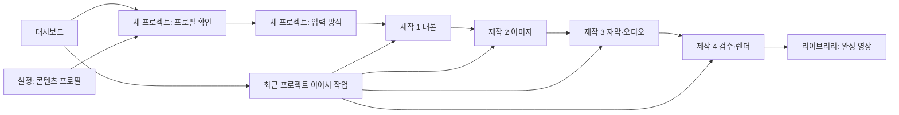
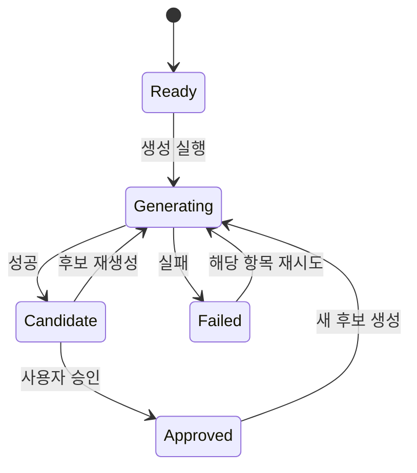

# 개인용 V1 PC 와이어프레임

상태: UI 시각 설계와 화면 개편 구현의 기준으로 사용할 저충실도 검토안.

기준 문서:

- [개인용 V1 최종 유저 플로우](./PERSONAL_V1_FINAL_USER_FLOW.md)
- [개인용 V1 화면 정보구조](./PERSONAL_V1_SCREEN_INFORMATION_ARCHITECTURE.md)

목표: 한 명의 사용자가 현재 해야 할 작업과 수정 영향을 놓치지 않고, 장면·대사 라인 단위로 결과물을 정밀하게 완성하도록 화면의 실제 배치와 상호작용을 정한다.

## 1. 와이어프레임 전제

### 대상 환경

- PC 전용이다.
- 기준 화면은 `1440 × 900`이며, `1280px` 이상의 데스크톱 폭을 지원한다.
- 앱 전역 사이드바를 제외한 제작 작업공간은 가능한 한 넓게 사용한다.
- `1280px` 부근에서 우측 인스펙터는 접을 수 있어야 한다.
- 모바일 내비게이션과 모바일 제작 화면은 설계하지 않는다.

### 핵심 배치 원칙

1. 전역 사이드바에는 `대시보드`, `제작`, `라이브러리`, `설정`만 둔다.
2. 화면마다 강조되는 주요 행동은 현재 상태 기준 하나만 둔다.
3. 제작 화면은 `장면·라인 탐색기 / 주 작업영역 / 선택 항목 인스펙터`를 기본으로 한다.
4. 오류는 전역 알림함보다 발생한 장면·라인·파일 가까이에 표시한다.
5. 새로운 생성 결과가 성공하기 전까지 기존 승인 자산을 유지한다.
6. 자동 저장, 변경 영향, 차단 오류는 제작 작업공간에서 항상 확인할 수 있다.
7. 긴 로그, raw JSON, 템플릿 좌표 편집은 기본 화면에서 접어 둔다.

## 2. 화면 전환 구조



## 3. 공통 화면 골격

### PC 전역 셸

```text
┌──────────────────┬────────────────────────────────────────────────────────────────────────────┐
│ 숏메이커          │ 화면 제목                                      장시간 작업 / 조치 필요 상태 │
│ 로컬 제작         ├────────────────────────────────────────────────────────────────────────────┤
│                  │                                                                            │
│ ● 대시보드        │                                                                            │
│   제작            │                           현재 화면 본문                                  │
│   라이브러리      │                                                                            │
│   설정            │                                                                            │
│                  │                                                                            │
│                  │                                                                            │
└──────────────────┴────────────────────────────────────────────────────────────────────────────┘
```

권장 폭:

| 영역 | 기준 |
| --- | --- |
| 전역 사이드바 | `200~216px` 고정 |
| 본문 최대 폭 | 대시보드·설정은 읽기 쉬운 최대 폭 적용, 제작은 전체 폭 사용 |
| 화면 좌우 여백 | `24px` |
| 화면 섹션 간격 | `16~24px` |

전역 셸에서 제거한다.

- 사용자명과 로그아웃 메뉴
- 작업공간 전환
- 관리자 모드
- 퀵 스튜디오
- 레이아웃 스튜디오
- 휴지통 1차 메뉴
- 발행 상태와 분석
- 크레딧·라이선스

정상 연결 상태는 전역에 반복 표시하지 않는다. Codex, Typecast 또는 저장소에 사용자의 조치가 필요할 때만 화면 제목 우측에 한 줄 경고를 표시한다.

## 4. 대시보드

주목적: `새로 시작`, `이어서 작업`, `문제 해결` 중 다음 행동을 고른다.

```text
┌──────────────────────────────────────────────────────────────────────────────────────────────┐
│ 대시보드                                                               [새 프로젝트 만들기] │
├──────────────────────────────────────────────────────────────────────────────────────────────┤
│ 마지막 프로젝트                                                                              │
│ ┌────────────────────────────────────────────────────┐  ┌──────────────────────────────────┐ │
│ │ 경제 상식 12화                                     │  │ 조치 필요                         │ │
│ │ 콘텐츠 프로필: 경제 1분                            │  │ 이미지 생성 실패 1건              │ │
│ │ 마지막 안정 단계: 이미지 · 장면 08                 │  │ 렌더 중단 1건                      │ │
│ │ 12분 전 자동 저장                                  │  │ 저장소 경로 확인 필요              │ │
│ │                                      [이어서 작업] │  │                  [문제 작업 보기] │ │
│ └────────────────────────────────────────────────────┘  └──────────────────────────────────┘ │
│                                                                                              │
│ 최근 프로젝트                                                     [라이브러리에서 모두 보기] │
│ 프로젝트명             프로필            상태              마지막 수정              행동   │
│ 경제 상식 12화         경제 1분          이미지 검수        12분 전                  [열기] │
│ 역사 속 오늘 08화      역사 이야기       음성 생성 필요     어제                     [열기] │
│                                                                                              │
│ 최근 완성 영상                                                     [완성 영상 모두 보기]      │
│ [썸네일] 경제 상식 11화  00:58  오늘 14:20  [재생] [폴더 열기]                              │
└──────────────────────────────────────────────────────────────────────────────────────────────┘
```

규칙:

- `새 프로젝트 만들기`를 페이지의 유일한 상단 주요 CTA로 둔다.
- 마지막 프로젝트 카드에서는 `이어서 작업`을 카드 내부의 맥락 행동으로만 강조한다. 화면 전체의 primary는 `새 프로젝트 만들기` 하나다.
- 조치할 항목이 없으면 `조치 필요` 패널을 숨기고 마지막 프로젝트 영역을 넓힌다.
- 중단된 장시간 작업은 `진행 중`으로 남기지 않고 `중단됨·재시도 필요`로 표시한다.
- 통계, 발행 현황, 전체 템플릿, 전체 자산 관리는 넣지 않는다.

## 5. 새 프로젝트 시작

새 프로젝트는 전체 설정 폼이 아니라 두 개의 짧은 화면으로 구성한다. 뒤로 가더라도 선택한 프로필을 유지한다.

### 5.1 콘텐츠 프로필 확인

```text
┌──────────────────────────────────────────────────────────────────────────────────────────────┐
│ 새 프로젝트                                         1 프로필 확인 ━━━ 2 입력 방식            │
├──────────────────────────────────────────────────────────────────────────────────────────────┤
│ 콘텐츠 프로필                                                                               │
│ 최근 사용 프로필은 제안할 수 있지만 사용자가 직접 확인해야 합니다.                           │
│                                                                                              │
│ ┌───────────────────────────────────────────────┐  ┌───────────────────────────────────────┐ │
│ │ ● 경제 1분                                    │  │ 선택한 기본값                         │ │
│ │ YouTube: 경제를 쉽게                          │  │ 출력: Shorts 1080×1920                │ │
│ │ 템플릿: 클린 자막                             │  │ 기본 보이스: 나레이터 A               │ │
│ │ 기본 배속: 1.08x · 캐릭터 2명                 │  │ BGM: bright-01 · SFX: 보통            │ │
│ ├───────────────────────────────────────────────┤  │ 이미지: clean editorial               │ │
│ │ ○ 역사 이야기                                 │  │ 프로필 수정은 새 프로젝트에만 반영    │ │
│ │ YouTube: 오늘의 역사                          │  └───────────────────────────────────────┘ │
│ │ 템플릿: 다큐                                  │                                            │
│ └───────────────────────────────────────────────┘                                            │
│ [프로필 관리]                                                  [이 프로필로 계속]             │
└──────────────────────────────────────────────────────────────────────────────────────────────┘
```

상태:

- 프로필이 하나여도 사용자가 선택 내용을 확인한 뒤 진행한다.
- 필수 기본 보이스나 저장소가 잘못되었으면 요약 패널에서 경고하고 수정 위치를 연다.
- 프로필 세부 편집은 `설정 > 콘텐츠 프로필`로 이동한다.

### 5.2 입력 방식과 첫 입력

```text
┌──────────────────────────────────────────────────────────────────────────────────────────────┐
│ 새 프로젝트                                         1 프로필 확인 ━━━ 2 입력 방식            │
├──────────────────────────────────────────────────────────────────────────────────────────────┤
│ [● 주제로 시작]              [○ 전체 대본으로 시작]                                          │
│                                                                                              │
│ 프로젝트명                                                                                   │
│ [경제 상식 12화                                                                    ]         │
│                                                                                              │
│ 만들고 싶은 영상 주제                                                                       │
│ [금리가 오르면 왜 집값이 내려가는지 1분 안에 설명해줘                              ]         │
│                                                                                              │
│ 적용할 콘텐츠 프로필: 경제 1분  ·  템플릿: 클린 자막  ·  기본 보이스: 나레이터 A             │
│                                                                                              │
│ [이전]                                           [프로젝트 만들고 대본 단계 열기]             │
└──────────────────────────────────────────────────────────────────────────────────────────────┘
```

입력 방식에 따라 중앙 입력만 바뀐다.

- `주제로 시작`: 짧은 주제 입력과 선택적 참고사항
- `전체 대본으로 시작`: 큰 대본 입력창과 `원문은 기본적으로 다시 쓰지 않음` 안내

프로젝트 생성 순간 선택한 프로필 기본값을 `profileSnapshot`으로 복사한다.

## 6. 제작 작업공간 공통 프레임

```text
┌──────────────────────────────────────────────────────────────────────────────────────────────┐
│ 제작 / 경제 상식 12화        [경제 1분 · 프로필 스냅샷]  저장됨  1080×1920  [프로젝트 설정] │
│ 프로필과 다른 값 2개 · 변경 영향 3개 · 차단 오류 0                                          │
├──────────────────────────────────────────────────────────────────────────────────────────────┤
│ [1 대본 ✓]  [2 이미지 다시 필요]  [3 자막·오디오]  [4 검수·렌더]                              │
├──────────────────┬─────────────────────────────────────────────┬─────────────────────────────┤
│ 장면·라인 탐색기 │ 주 작업영역                                  │ 선택 항목 인스펙터           │
│                  │                                             │                             │
│ 장면 01          │                                             │ 현재 장면 또는 라인의       │
│  └ 라인 01       │                                             │ 세부 설정·미리보기·오류     │
│  └ 라인 02       │                                             │                             │
│ 장면 02          │                                             │                             │
│                  │                                             │                             │
├──────────────────┴─────────────────────────────────────────────┴─────────────────────────────┤
│ 변경 영향: 이미지 2개와 미리보기를 다시 준비해야 합니다.               [영향 항목 보기]      │
└──────────────────────────────────────────────────────────────────────────────────────────────┘
```

권장 폭:

| 영역 | 기준 |
| --- | --- |
| 장면·라인 탐색기 | `220~240px` |
| 주 작업영역 | 가변, 최소 `520px` |
| 선택 항목 인스펙터 | `300~340px`, 접기 가능 |

`1280px` 부근에서는 인스펙터를 기본 접힘으로 둘 수 있다. 선택 항목의 상세가 필요한 순간에만 우측 드로어로 연다. 하단에 별도 로그 패널을 상시 두지 않는다.

### 단계 레일 상태

| 상태 | 표시 | 의미 |
| --- | --- | --- |
| 현재 | 굵은 단계명과 위치 표시 | 지금 편집 중 |
| 완료 | 체크 | 해당 단계 승인 완료 |
| 생성 중 | 진행 표시 | 일부 작업 실행 중 |
| 다시 필요 | 경고 표시 | 앞 단계 변경 때문에 갱신 필요 |
| 차단 | 오류 수 | 필수 자산 누락 또는 실패 |
| 미시작 | 중립 | 아직 작업하지 않음 |

단계 이동은 자유롭게 허용한다. 단, 필수 데이터가 없는 단계에서는 실행 버튼을 비활성화하고 원인을 바로 보여준다.

### 주요 CTA와 로컬 액션의 시각적 위계

텍스트 와이어프레임의 모든 대괄호가 같은 강조를 뜻하지 않는다. 실제 UI에서는 다음처럼 구분한다.

| 종류 | 위치와 표현 | 예시 |
| --- | --- | --- |
| 화면 primary | 주 작업영역 우하단, 현재 상태 기준 1개 | `미완료 라인 생성`, `후보 승인`, `최종 렌더 시작` |
| 단계 이동 | 단계 레일 또는 보조 버튼 | `이미지 단계로`, `자막·오디오 단계로` |
| 선택 항목 로컬 액션 | 우측 인스펙터 안, 범위를 버튼명에 표시 | `선택 라인 1개 재생성`, `장면 04만 재시도` |
| 일괄 액션 | 목록 상단의 보조 액션, 대상 수 표시 | `실패 라인 2개 재시도` |

단계 완료 조건을 충족하기 전에는 다음 단계 이동을 primary로 보이지 않는다. 단계 레일을 통한 자유 이동은 계속 허용한다.

## 7. 제작 1단계 — 대본

```text
┌──────────────────┬─────────────────────────────────────────────┬─────────────────────────────┐
│ 장면·라인 탐색기 │ 대본                                        │ 선택 장면                    │
│                  │ [주제 입력] [전체 대본]                     │ 장면 제목                    │
│ 장면 01          │                                             │ 등장 화자 후보               │
│  └ 라인 01       │ 장면 01  금리와 집값                        │ 등장 캐릭터 후보             │
│  └ 라인 02       │ [금리가 오르면 대출 이자가 비싸집니다.]     │ 이미지 설명 초안             │
│ 장면 02          │ [그래서 집을 살 수 있는 사람이 줄어듭니다.] │                             │
│                  │ [+ 장면] [라인 분리] [병합] [순서 변경]     │ [선택 장면만 다시 구조화]    │
│                  │ ▸ 음성 설정                                 │                             │
│                  │                                  [이미지 단계로]                          │
└──────────────────┴─────────────────────────────────────────────┴─────────────────────────────┘
```

접이식 `음성 설정`은 기본 접힘이며 다음 값만 담는다.

- 음성 방식: `단일 나레이션` 또는 `대화형/화자별`
- 나레이션·대사·남성·여성 기본 보이스와 미리듣기
- `화자 지정`과 화자별 보이스 확정
- 제작 배속

라인마다 배속이나 뒤 간격을 조정하는 UI는 두지 않는다. 문장 뒤 간격은 항상 `0ms`이고 배속은 프로젝트 전체에 하나만 적용한다. Typecast 실패는 해당 라인에 표시하고 다른 성공 라인은 유지한다. 전체 보이스 자산 관리와 복제 기능은 설정으로 보낸다.

현재 상태에 따른 주요 CTA:

| 상태 | 주요 CTA |
| --- | --- |
| 주제만 입력됨 | `AI 대본 생성` |
| 전체 대본 입력됨 | `장면·라인 구조 분석` |
| 구조 생성 완료 | `이미지 단계로` |

대본 편집 시 영향받는 장면·라인을 계산해 하단 변경 영향 바에 표시한다. 이미지 프롬프트, SFX, 자막 상세 편집은 이 단계에 열지 않는다.

`선택 장면만 다시 구조화`는 해당 장면과 그 하위 라인만 대상으로 한다. 여러 장면 또는 전체 대본을 다시 구조화할 때는 대상 수와 하위 단계 무효화 범위를 확인한 뒤 복구 지점을 만들고 실행한다.

## 8. 제작 2단계 — 이미지

```text
┌──────────────────┬─────────────────────────────────────────────┬─────────────────────────────┐
│ 장면 탐색기       │ 장면 이미지 그리드                          │ 선택 장면                    │
│ 01 승인됨 ✓      │ [장면 01 현재 승인 이미지]  [장면 02 후보]   │ 등장 캐릭터 [A] [B]         │
│ 02 후보 있음 ●   │ [장면 03 생성 필요]        [장면 04 실패 !]  │ 프롬프트                     │
│ 03 생성 필요 ○   │                                             │ [장면 이미지 설명          ] │
│ 04 실패 !        │ 새 생성은 후보로 추가되고 승인본은 유지됨   │                             │
│                  │                                             │ [장면 04만 GPT Image 2 재시도]│
│                  │                                             │ [이 후보 승인] [직접 교체]   │
│                  │                            [자막·오디오 단계로]                             │
└──────────────────┴─────────────────────────────────────────────┴─────────────────────────────┘
```

규칙:

- 중앙은 장면별 현재 승인 이미지와 새 후보를 구분한다.
- `생성`, `승인`, `교체`를 한 동작으로 합치지 않는다.
- 새 이미지 생성이 실패해도 기존 승인 이미지는 보존한다.
- 생성·재생성 버튼에는 `장면 04만`, `미완료 장면 3개`처럼 실제 대상을 표시한다.
- 캐릭터 기준 정보 수정은 작은 보조 드로어 또는 프로젝트 설정에서 명시적으로 연다.

현재 상태에 따른 주요 CTA:

| 상태 | 주요 CTA |
| --- | --- |
| 시각 자산이 없는 장면이 있음 | `선택 장면 생성` 또는 `미완료 장면 생성` |
| 생성 실패 장면이 있음 | `선택 장면 재시도` |
| 새 후보가 있음 | `후보 승인` |
| 모든 장면에 승인 자산이 있음 | `자막·오디오 단계로` |

미완료·실패·승인 대기 장면이 있는 동안 `자막·오디오 단계로`는 보조 이동으로만 보인다.

여러 장면을 한꺼번에 생성하거나 재생성할 때는 대상 장면 수, 예상 변경 영향, 복구 지점 생성을 확인한 뒤 실행한다.

## 9. 제작 3단계 — 자막·오디오

```text
┌──────────────────┬─────────────────────────────────────────────┬─────────────────────────────┐
│ 장면·라인 탐색기 │ 오디오 중심 미리보기                         │ 선택 항목                    │
│ 장면 01          │ [▶ 재생]  00:00 ━━━━━●━━━━━━━━ 00:58       │ 자막: 프로필 기본           │
│ 장면 02 ●       │                                             │ 위치·크기 요약              │
│ 장면 03          │ 자막  [스타일 ▼] [위치 ▼] [크기]           │                             │
│                  │ BGM   [켜짐] bright-01.mp3  볼륨 20%        │ BGM 또는 SFX 파일 상세      │
│                  │ SFX   강도 [적게] [보통] [많이]             │ [교체] [삭제]               │
│                  │       장면 02 효과음 2개  [목록 보기]        │                             │
│                  │                                             │ [선택 구간 미리듣기]        │
│                  │                                  [검수 시작]                              │
└──────────────────┴─────────────────────────────────────────────┴─────────────────────────────┘
```

규칙:

- 전문 멀티트랙 타임라인은 개인용 V1 범위에 넣지 않는다.
- 프로젝트에서는 사용할 BGM·SFX 참조와 적용값만 관리한다.
- 파일 자체는 `라이브러리 > 보조 자산`, 기본값은 `설정 > 콘텐츠 프로필`이 소유한다.
- SFX 없음은 경고일 수 있지만, 깨진 파일과 누락된 자막 타이밍은 해당 항목에 오류로 표시한다.
- 주요 CTA는 `검수 시작`이다.

## 10. 제작 4단계 — 검수·렌더

같은 단계 안에서 `검수`와 `렌더`를 상하 섹션으로 구분한다. 두 영역을 같은 강조 수준으로 보이지 않는다.

```text
┌──────────────────┬─────────────────────────────────────────────┬─────────────────────────────┐
│ 품질 이슈         │ 검수                                        │ 이슈 상세                    │
│ 음성 1건 !       │ ┌─────────────────────────────────────────┐ │ 라인 02 음성 누락           │
│ 이미지 1건 !     │ │        통합 미리보기 9:16              │ │ 원인: Typecast 생성 실패    │
│ 자막 0건         │ └─────────────────────────────────────────┘ │ [대본 단계의 라인 02 열기]  │
│                  │ [미리보기 업데이트]                         │                             │
│                  │─────────────────────────────────────────────│                             │
│                  │ 렌더 사전검사  차단 2 · 경고 1              │ 렌더 스냅샷                 │
│                  │ 차단 항목을 해결해야 최종 렌더 가능          │ 아직 없음                   │
│                  │                                             │ 최종 렌더 시작 시 생성      │
│                  │                                  [사전검사 실행]                            │
└──────────────────┴─────────────────────────────────────────────┴─────────────────────────────┘
```

상태에 따라 하나의 주요 CTA만 바뀐다.

```text
미리보기 오래됨  →  미리보기 업데이트
미리보기 최신    →  사전검사 실행
사전검사 차단    →  차단 항목 해결, 최종 렌더 비활성화
경고만 있음      →  경고를 표시하고 최종 렌더 가능
사전검사 통과    →  최종 렌더 시작
렌더 진행 중     →  진행 상태만 표시
렌더 실패        →  같은 스냅샷으로 재시도
렌더 완료        →  완성 영상 재생
```

`renderSnapshot` 표시 시점:

| 상태 | 우측 또는 렌더 상세 표시 |
| --- | --- |
| 사전검사 전·차단 | `렌더 스냅샷 없음 · 최종 렌더 시작 시 생성` |
| 사전검사 통과 | `최종 렌더 시작 시 스냅샷 생성 예정` |
| 렌더 진행·실패·완료 | snapshot ID, 생성 시각, 동결된 입력과 저장 위치 |
| 렌더 실패 | 위 정보와 함께 `같은 스냅샷으로 재시도` |

`1280px` 부근에서는 품질 이슈 목록만 좌측에 유지하고 이슈 상세와 렌더 스냅샷 상세를 우측 드로어로 접는다. 렌더 스냅샷 요약은 렌더 섹션 안에서 확인할 수 있다.

렌더 완료 상태:

```text
┌──────────────────────────────────────────────────────────────────────────────────────────────┐
│ 렌더 완료                                                                                    │
│ [완성 영상 플레이어]                                                                         │
│ 경제 상식 12화.mp4 · 00:58 · 1080×1920 · 라이브러리 등록 완료                                │
│ [재생] [폴더 열기] [파일 복사] [수정본 만들기] [렌더 로그]                                   │
└──────────────────────────────────────────────────────────────────────────────────────────────┘
```

## 11. 프로젝트 설정 드로어

제작 작업공간의 상단 `프로젝트 설정`에서 우측 드로어로 연다. 제작 단계의 세부 편집 기능을 중복해서 넣지 않는다.

```text
┌──────────────────────────────────────────┐
│ 프로젝트 설정                       [×] │
├──────────────────────────────────────────┤
│ 프로젝트명                              │
│ [경제 상식 12화                       ] │
│                                          │
│ 콘텐츠 프로필 스냅샷                    │
│ 경제 1분 · 생성 당시 2026-07-19          │
│ 프로필 원본과 다른 값 2개  [차이 보기]   │
│                                          │
│ 프로필 → 프로젝트                        │
│ [새 기본값을 이 프로젝트에 선택 적용]    │
│                                          │
│ 프로젝트 → 프로필                        │
│ [현재 값을 프로필 기본값으로 저장]       │
│                                          │
│ 출력 규격  1080×1920                     │
│ 템플릿    클린 자막             [변경]   │
│                                          │
│                                  [완료]  │
└──────────────────────────────────────────┘
```

프로필 원본 적용과 프로젝트 값을 프로필에 저장하는 행동은 방향이 반대이므로 서로 다른 섹션에 둔다. 둘 다 변경 목록과 영향 범위를 확인하는 확인창을 거쳐 실행한다. 일반 프로필 선택 드롭다운으로 즉시 바꾸지 않는다.

## 12. 라이브러리

```text
┌──────────────────────────────────────────────────────────────────────────────────────────────┐
│ 라이브러리                                                                                   │
│ [프로젝트] [완성 영상] [보조 자산]                                                           │
├──────────────────────────────────────────────────────────────────────────────────────────────┤
│ 검색 [                              ]   프로필 [전체 ▼]   상태 [전체 ▼]                      │
├──────────────────────────────────────────────────────────────────────────────────────────────┤
│ 프로젝트명          프로필        상태             마지막 안정 단계       수정 시각          │
│ 경제 상식 12화      경제 1분      이미지 검수      이미지 · 장면 08       12분 전            │
│ 역사 속 오늘 08화   역사 이야기   렌더 실패        renderSnapshot 있음    어제               │
│                                                        [이어서 작업] [복제] [상세 ···]       │
└──────────────────────────────────────────────────────────────────────────────────────────────┘
```

탭별 기본 표현과 행동을 다르게 한다.

| 탭 | 기본 표현 | 주요 행동 | 소유 정보 |
| --- | --- | --- | --- |
| 프로젝트 | 상태 중심 테이블 | 이어서 작업 | 편집 상태, 마지막 안정 단계, 실패·중단 스냅샷 |
| 완성 영상 | 썸네일 중심 목록 | 재생 또는 폴더 열기 | 최종 MP4, 성공한 스냅샷, 렌더 로그 |
| 보조 자산 | 폴더·파일 탐색기 | 미리듣기 또는 프로젝트에 사용 | 이미지·영상·BGM·SFX 파일 자체 |

삭제·복구는 각 행의 보조 메뉴 또는 `설정 > 저장소·복구`에서 연다.

## 13. 설정

설정은 카드 허브가 아니라 `상위 탭 / 목록 / 상세` 구조로 만든다.

```text
┌──────────────────────────────────────────────────────────────────────────────────────────────┐
│ 설정                                                                                        │
│ [콘텐츠 프로필] [외부 연결] [템플릿·출력] [저장소·복구] [고급]                              │
├───────────────────────┬──────────────────────────────────────────────────────────────────────┤
│ 콘텐츠 프로필         │ 경제 1분                                                             │
│                       │ 기본 정보                                                             │
│ ● 경제 1분            │ 이름 · 현재 대응 YouTube 채널                                       │
│   역사 이야기         │                                                                      │
│   제품 리뷰           │ 템플릿·출력 / 음성·배속·무음 / 이미지 스타일 / 캐릭터               │
│                       │ 자막·BGM·SFX 기본값                                                   │
│ [+ 프로필]            │                                                                      │
│                       │ 기존 프로젝트에는 자동 적용되지 않습니다.                            │
│                       │                                                        [변경 저장]   │
└───────────────────────┴──────────────────────────────────────────────────────────────────────┘
```

탭별 역할:

| 탭 | 포함 | 기본 화면에서 제외 |
| --- | --- | --- |
| 콘텐츠 프로필 | 프로젝트 시작 기본값, 캐릭터, 이미지 스타일 | 기존 프로젝트 자동 일괄 변경 |
| 외부 연결 | Codex 구독, Typecast 상태와 재연결 | OpenAI API 키, 플랫폼 발행 연결 |
| 템플릿·출력 | 공유 템플릿, 출력 규격, 렌더 기본값 | 좌표·JSON 상시 노출 |
| 저장소·복구 | 로컬 경로, 자동 저장, 백업, 삭제 복구 | 클라우드 워크스페이스 |
| 고급 | 레이아웃 편집, raw JSON, 전역 렌더 진단 | 제작 화면 진입용 기능 |

## 14. 상태와 피드백 규칙

### 생성 작업



화면 규칙:

- `Generating` 동안 기존 승인 결과를 유지한다.
- 새 결과는 `Candidate`로 추가되며 자동 승인하지 않는다.
- 실패는 해당 라인 또는 장면에 남기고 전체 단계의 성공 결과를 지우지 않는다.
- 일괄 재생성 전에 자동 복구 지점을 만든다.

### 자동 저장

- 편집 중에는 `저장 중…`, 완료 후에는 `저장됨`을 프로젝트 헤더에 표시한다.
- 저장 실패는 헤더와 실패한 입력 가까이에 함께 표시한다.
- 앱 재시작 시 마지막 안정 단계와 마지막 선택 장면·라인으로 복귀한다.

### 주요 CTA 상태

| 상황 | 처리 |
| --- | --- |
| 필수 입력 없음 | 비활성화하고 버튼 근처에 이유 표시 |
| 외부 연결 필요 | 연결 설정 링크와 함께 비활성화 |
| 일부 실패 | 성공 항목 유지, 실패 항목 재시도 CTA 제공 |
| 하위 단계 무효화 | 이동 허용, 단계 레일과 하단 영향 바에 표시 |
| 장시간 작업 중 | 중복 실행 비활성화, 대상 수와 진행률 표시 |
| 작업 중 앱 종료 | 다음 실행에서 `중단됨·재시도 필요`로 전환 |

## 15. 현재 구현과의 연결

기존 화면을 한 번에 폐기하지 않고 다음 영역을 재사용할 수 있다.

| 목표 영역 | 기존 코드에서 재사용 후보 |
| --- | --- |
| 전역 셸 | `components/AppLayout.tsx` |
| 제작 라우트와 오케스트레이션 | `app/shorts-json-studio/page.tsx` |
| 기존 단계형 셸 | `app/shorts-json-studio/components/studio-mode-shells.tsx` |
| 대본 입력·구조 데이터 | `StudioScriptJsonPanel`과 관련 hooks |
| 통합 미리보기·장면 검수 | `StudioPreviewPanel` |
| 준비·사전검사·렌더 | `StudioRenderPublishPanel` |
| 렌더 결과 | `StudioResultPanel` |
| 히스토리·복구 | `StudioHistoryPanel` |
| 템플릿 선택 | `StudioTemplateQuickPickerPanel` |
| 보조 자산 | `Assets*`, `StudioPreselectedMediaPanel` |

새로 분리하거나 추가해야 할 핵심 영역:

- 콘텐츠 프로필 선택과 스냅샷 확인
- 새 프로젝트 시작 화면
- 프로젝트 컨텍스트 헤더와 프로젝트 설정 드로어
- 4단계 상태 레일
- 장면·라인 탐색기
- 대본 단계의 접이식 음성 설정
- 이미지 후보와 승인 상태
- 변경 영향 계산 결과의 고정 표시
- 검수·렌더 상태 기반 단일 CTA

## 16. 와이어프레임 승인 기준

- 대시보드에서 한 번의 명확한 행동으로 새 프로젝트를 시작할 수 있다.
- 프로젝트 생성 전 콘텐츠 프로필을 명시적으로 확인한다.
- 제작 작업공간의 상위 단계가 네 개뿐이다.
- 장면·라인 선택 상태가 단계 사이에서 유지된다.
- 음성은 대본 단계의 접이식 `음성 설정`에서 음성 방식·화자·보이스·제작 배속을 확인할 수 있다.
- 이미지는 기존 승인본과 새 후보를 구분하고 장면별로 재생성할 수 있다.
- SFX는 자동 추천을 빠르게 듣고 삭제·교체할 수 있지만 전문 편집기로 확장되지 않는다.
- 미리보기, 사전검사, 최종 렌더가 같은 강조 수준으로 동시에 노출되지 않는다.
- 오류를 클릭하면 원인 단계와 장면·라인으로 이동한다.
- 프로젝트와 완성 영상이 라이브러리에서 다른 행동을 제공한다.
- 콘텐츠 프로필 기본값과 프로젝트 임시 변경값이 섞이지 않는다.
- 모바일, 발행, 판매, 사용자·관리자 기능 없이 화면 흐름이 완결된다.

## 17. 다음 단계와의 경계

이 문서는 기능의 실제 위치, 패널 배치, 상태와 행동 우선순위를 확정한다. 다음 단계에서는 이 와이어프레임을 바탕으로 색상, 타이포그래피, 컴포넌트 규격, 여백, 아이콘과 상호작용 상세를 포함한 UI 디자인 시스템을 정한다. 애플리케이션 코드 개편은 그 다음에 화면 단위로 진행한다.
