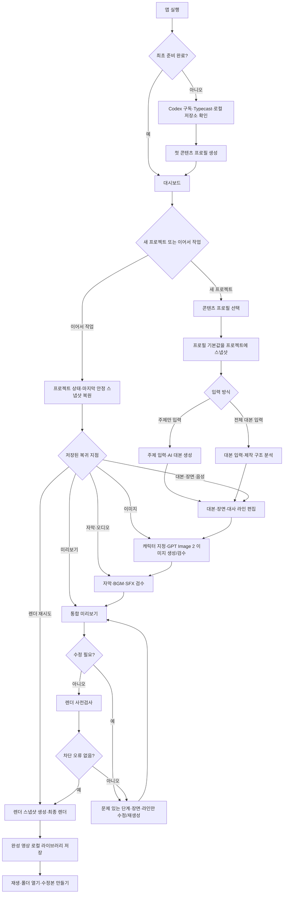

# 개인용 V1 최종 유저 플로우

상태: 화면 정보구조와 와이어프레임의 기준으로 사용할 최종 검토안.

목표: 한 명의 사용자가 콘텐츠 프로필의 기본값을 불러와 대본과 음성 설정, 이미지, 오디오를 단계별로 정밀하게 검수한 뒤 최종 MP4를 로컬에 완성한다.

## 1. 이번 플로우의 완료선

```text
콘텐츠 프로필 선택
→ 새 프로젝트
→ 주제 또는 전체 대본 입력
→ 대본·장면·음성 확정
→ 캐릭터·이미지 확정
→ 자막·BGM·SFX 확정
→ 통합 미리보기 검수
→ 렌더 사전검사
→ 최종 렌더
→ 로컬 라이브러리 저장
```

개인용 V1의 완료 기준은 `최종 렌더와 로컬 라이브러리 저장`이다. 자동 발행, 판매, 라이선스, 크레딧, 모바일은 완료 기준에 포함하지 않는다.

## 2. 핵심 작업 단위

| 단위 | 의미 |
| --- | --- |
| 콘텐츠 프로필 | 하나의 콘텐츠 운영 단위를 위한 제작 기본값 묶음. 현재는 실제 YouTube 채널 하나와 대응하고, 향후 같은 프로필에 Instagram·TikTok 계정을 연결할 수 있다. |
| 프로젝트 | 최종 영상 한 편을 만드는 독립 작업. 생성 시 콘텐츠 프로필 기본값을 복사해 보관한다. |
| 장면 | 하나의 시각적 상황과 하나 이상의 대사 라인을 묶는 편집 단위. |
| 대사 라인 | 한 화자가 한 번에 말하는 최소 음성·자막 단위. |
| 생성 자산 | 대본, Typecast 음성, GPT Image 2 이미지, SFX 추천처럼 렌더 전에 만들어지는 재료. |
| 렌더 결과 | 확정된 생성 자산과 템플릿을 조합한 최종 MP4. |
| 로컬 라이브러리 | 완성 파일을 로컬 폴더에 저장하고, 해당 파일과 프로젝트·렌더 스냅샷을 앱 내부 인덱스에 등록한 상태. |

## 3. 전체 플로우



## 4. 단계별 사용자 흐름

### 0단계. 최초 준비

최초 한 번만 진행한다.

- 외부 생성 기능을 위해 Codex가 ChatGPT 구독으로 연결되어 있는지 확인한다.
- Typecast 연결과 사용할 보이스 목록을 확인한다.
- 프로젝트와 완성 영상을 저장할 로컬 위치를 확인한다.
- 첫 콘텐츠 프로필을 만든다.

연결이 끊겨도 기존 프로젝트 열기와 텍스트 편집은 허용한다. 실제 생성 버튼을 누르는 시점에 필요한 연결만 차단하고 복구 방법을 보여준다.

### 1단계. 대시보드에서 작업 선택

사용자는 둘 중 하나를 선택한다.

- 최근 프로젝트를 마지막 안정 단계부터 이어서 작업한다.
- 콘텐츠 프로필을 선택하고 새 프로젝트를 만든다.

중단되었거나 실패한 작업은 계속 `진행 중`으로 표시하지 않는다. 앱 재시작 시 `중단됨·재시도 필요` 상태로 전환한다.

### 2단계. 콘텐츠 프로필 선택과 프로젝트 생성

새 프로젝트를 시작하기 전에 콘텐츠 프로필을 반드시 선택한다.

프로젝트 생성 시 다음 값을 복사한다.

- 템플릿과 출력 규격
- 기본 화자·Typecast 보이스
- 기본 배속과 무음 제거 정책
- 기본 BGM과 자막 스타일
- AI 이미지 기본 스타일
- AI 이미지용 고정 캐릭터 프로필 0명 이상
- SFX 자동 배치 정책과 강도

프로필 기본값은 프로젝트에 스냅샷으로 저장한다. AI 이미지에서 사용할 고정 캐릭터는 프로젝트가 프로필 ID 한 개만 저장하고, 프롬프트 준비·자동 생성 시점마다 최신 콘텐츠 프로필의 외형 설명과 기준 이미지를 다시 조회한다. 이미지 스타일과 자동 설계 캐릭터는 프로젝트 상태로 유지한다.

### 3단계. 입력 방식 선택

#### 주제만 입력

사용자가 주제와 필요한 제약을 입력하면 `gpt-5.6-sol / medium / Fast`로 대본 초안을 만든다. 사용자는 대본을 직접 수정하거나 필요한 부분만 다시 생성한다.

#### 전체 대본 입력

사용자가 입력한 원문은 임의로 다시 쓰지 않는다. 기본 동작에서 AI는 제작을 위해 다음 구조만 제안한다. 사용자가 별도의 `대본 다듬기`를 명시적으로 실행했을 때만 원문을 재작성한다.

- 장면 분리
- 대사 라인 분리
- 화자 후보
- 등장 캐릭터 후보
- 이미지 장면 설명
- SFX 후보 지점

두 입력 방식은 다음 단계부터 하나의 흐름으로 합쳐진다.

### 4단계. 대본·장면·대사 라인 편집

사용자가 영상의 뼈대를 확정한다.

- 장면 추가·삭제·순서 변경
- 장면별 본문 수정
- 대사 라인 분리·병합
- 대사 라인별 화자 지정
- 장면별 등장 캐릭터 지정
- 장면별 이미지 설명 수정

`장면`은 이미지 한 장과 반드시 1:1일 필요는 없지만, 기본적으로 하나의 시각적 상황을 공유한다. 동일 이미지를 여러 장면에서 재사용하거나 한 장면에 여러 이미지 변형을 쓰는 것은 허용한다.

같은 단계의 접이식 `음성 설정`에서 음성 관련 값을 함께 확정한다. 다음 두 제작 방식을 모두 지원한다.

- 전체 대본을 하나의 보이스로 읽기
- 대사 라인마다 서로 다른 화자와 보이스 사용하기

사용자는 `음성 설정`에서 다음 값을 확인한다.

- 음성 방식: 단일 나레이션 또는 대화형/화자별
- 논리 화자 지정과 화자별 Typecast 보이스
- 제작 배속
- TTS 앞뒤 무음 제거 결과

라인마다 배속이나 뒤 간격을 따로 조정하지 않는다. 문장 뒤 간격은 항상 `0ms`이고 배속은 프로젝트 전체에 하나만 적용한다. 음성 생성 실패는 해당 라인만 재시도하며, 정상 생성된 다른 라인은 다시 만들지 않는다.

### 5단계. 캐릭터·이미지 준비와 검수

자동 AI 이미지는 OpenAI API 키가 아니라 ChatGPT/Codex 구독 연결의 `$imagegen`으로 생성하며, 내장 이미지 모델은 GPT Image 2를 사용한다. 수동 AI 모드는 실제 이미지를 생성하지 않고 외부 생성 도구에 사용할 프롬프트만 준비한다.

이미지 준비 방식은 다음 세 가지로 분리한다.

| 방식 | 사용자가 정하는 값 | 실행 범위 |
|---|---|---|
| 크롤링 이미지 | 크롤링 세부 방식 | 스타일과 캐릭터 설정을 사용하지 않고 관련 이미지를 검색한다. |
| AI 이미지(수동 생성) | 선택적 고정 캐릭터 한 명 또는 선택적 이미지 스타일 | 장면별 기본·장면·최종 프롬프트까지만 준비한다. 사용자가 외부에서 이미지를 만든 뒤 URL·파일·내 자산으로 적용한다. |
| AI 이미지(자동 생성) | 선택적 고정 캐릭터 한 명 또는 선택적 이미지 스타일 | 프롬프트를 준비한 뒤 실제 이미지 후보 생성·저장까지 수행한다. |

고정 캐릭터는 콘텐츠 프로필에서 이름, identity 설명, 기준 이미지를 관리한다. 제작 화면에서는 프로젝트 전체에 적용할 한 명을 사용자가 직접 선택하며, 저장 캐릭터가 한 명뿐이어도 자동 선택하지 않는다. 선택한 캐릭터가 삭제되면 선택 안 함으로 처리한다.

유효한 고정 캐릭터가 선택되면 해당 한 명을 모든 장면에 사용하고 이미지 스타일과 자동 캐릭터 상태를 요청에서 제외한다. 선택하지 않으면 수동·자동 모드 모두 이미지 스타일을 선택적으로 지정할 수 있고, 비워 두면 대본에 맞게 결정한다. 자동 모드의 `characterProfiles`는 고정 캐릭터 미선택 상태에서만 프로젝트 내부 일관성 상태로 사용한다.

모든 AI 이미지 프롬프트에는 `no text`와 `square 1:1`을 서버 시스템 규칙으로 적용한다. 이 규칙은 스타일 프롬프트의 일부가 아니며 사용자가 끌 수 없다.

자동 모드에서 생성한 이미지는 이미지가 없는 장면에 즉시 적용한다. 이미 이미지가 있는 장면은 생성 결과를 후보로만 추가하고, 교체 여부는 사용자가 결정한다. 따라서 자동 모드에는 별도의 후보 승인 단계가 없고, 모든 장면에 이미지가 준비되면 바로 다음 단계로 넘어간다. 크롤링 모드는 기존대로 후보를 승인해야 현재 이미지가 된다.

사용자는 장면마다 다음 작업을 수행한다.

- 수동 모드에서 프롬프트를 복사하고 외부 생성 결과를 직접 적용
- 자동 모드에서 해당 장면만 재생성하고 필요하면 후보를 골라 교체
- 고정 캐릭터 수정이 필요하면 콘텐츠 프로필로 이동
- 직접 보유한 이미지로 교체
- 다른 장면의 이미지 재사용

재생성 중에는 기존 이미지를 유지한다. 이미 이미지가 있는 장면은 새 이미지가 성공하고 사용자가 교체를 선택해야 바뀐다.

### 6단계. 자막·BGM·SFX 검수

콘텐츠 프로필 기본값으로 초기 상태를 만들고 사용자는 필요한 부분만 조정한다.

- 자막 스타일·위치·크기
- BGM 선택·볼륨·켜기/끄기
- SFX 자동 강도: 적게·보통·많이
- 장면 또는 라인별 SFX 삭제·교체·재추천

SFX는 전문 타임라인 편집기를 목표로 하지 않는다. 자동 추천 결과를 듣고 어색한 지점만 빠르게 수정하는 흐름을 우선한다.

### 7단계. 통합 미리보기와 품질 검수

미리보기는 실시간 또는 저해상도 내부 검수 결과이며 완성 영상으로 라이브러리에 저장하지 않는다. 프레임 정확도를 별도로 확인해야 할 때만 선택적으로 `검수본 렌더`를 만들 수 있고, 필수 완료 단계는 아니다. 라이브러리에 최종 결과로 등록되는 것은 9단계의 최종 렌더 MP4다.

미리보기에서 다음을 한 번에 확인한다.

- 대본과 장면 순서
- 화자·보이스 매칭
- 배속과 불필요한 음성 공백
- 이미지와 장면 내용의 일치
- 캐릭터 일관성
- 자막 싱크와 가독성
- BGM과 음성의 밸런스
- SFX 위치와 강도
- 전체 영상 길이와 템포

수정이 필요하면 프로젝트 전체를 다시 만들지 않는다. 문제 있는 단계, 장면 또는 대사 라인으로 돌아가 부분 수정한 뒤 미리보기를 다시 준비한다.

### 8단계. 렌더 사전검사

다음 항목은 렌더를 차단한다.

- 장면 또는 대사 라인이 없음
- 빈 대사 라인이 있음
- 화자 또는 Typecast 보이스가 누락됨
- TTS 생성에 실패한 라인이 있음
- 이미지가 누락되거나 생성에 실패한 장면이 있음
- 필수 템플릿 슬롯 또는 자막 타이밍이 없음
- 깨진 BGM·SFX 파일이 있음
- 미리보기 이후 변경된 내용이 아직 반영되지 않음
- 출력 경로 또는 로컬 저장 공간을 사용할 수 없음

이미 생성된 음성·이미지 자산이 모두 정상이라면 최종 렌더에 Codex나 Typecast 연결은 필요하지 않다. 누락 자산이 있어 외부 생성이 필요한 경우에만 해당 연결 상태를 차단 오류로 표시한다.

다음 항목은 경고하되 사용자가 진행할 수 있다.

- BGM 또는 SFX를 사용하지 않음
- 목표보다 영상 길이가 길거나 짧음
- 일부 장면이 직접 교체 이미지임
- 캐릭터가 없는 프로젝트임

### 9단계. 최종 렌더와 결과

렌더 직전에 재현 가능한 `renderSnapshot`을 만든다. 여기에는 대본과 장면 구조, 이미지 파일 참조, TTS 오디오 파일 참조, BGM·SFX 파일 참조, 자막·타이밍 결과, 템플릿과 출력 설정을 동결된 렌더 입력으로 포함한다.

렌더 완료 후 제공한다.

- 완성 영상 재생
- 파일 위치 열기
- 파일 복사
- 같은 프로젝트 다시 열기
- 현재 프로젝트를 복제해 수정본 만들기
- 렌더 로그 확인

렌더 실패 시 이미지나 음성을 다시 생성하지 않는다. 같은 렌더 스냅샷으로 재시도한다.

## 5. 저장·복구 규칙

- 모든 편집은 로컬에 자동 저장한다.
- 대본 전체 재생성, 장면 재구성, 음성 일괄 재생성, 이미지 일괄 재생성 전에는 복구 지점을 만든다.
- 생성 실패는 기존 승인 자산을 덮어쓰지 않는다.
- 앱 종료 후 다시 열면 마지막 안정 단계와 선택했던 장면으로 돌아간다.
- 장시간 작업은 프로젝트별 작업 상태와 성공·실패 결과를 저장한다.
- 렌더 완료본은 당시의 프로젝트·렌더 스냅샷과 연결한다.

## 6. 변경 영향 규칙

| 변경 내용 | 다시 준비해야 하는 범위 |
| --- | --- |
| 대본·장면·대사 라인 변경 | 영향받은 음성·이미지 계획·SFX·미리보기·렌더 |
| 화자·보이스·배속 변경 | 영향받은 음성·미리보기·렌더 |
| 캐릭터·이미지 변경 | 영향받은 이미지·미리보기·렌더 |
| 자막·BGM·SFX 변경 | 미리보기·렌더 |
| 템플릿·출력 규격 변경 | 미리보기·렌더와 이미지 크롭 확인 |
| 콘텐츠 프로필 변경 | 기존 프로젝트에 자동 영향 없음 |

변경으로 무효화되지 않은 승인 자산은 그대로 유지한다.

## 7. 오류 처리 원칙

- Codex 연결 실패: 현재 편집 내용을 보존하고 재로그인 후 해당 작업만 재시도한다.
- GPT Image 2 실패: 해당 장면만 실패로 표시하고 재시도한다.
- Typecast 실패: 해당 대사 라인만 실패로 표시하고 보이스 설정 확인 후 재시도한다.
- SFX 누락: 해당 SFX를 제거하거나 교체한다.
- 렌더 실패: 원인 로그를 보여주고 같은 스냅샷으로 재시도한다.
- 네트워크 연결 없음: 로컬 편집은 계속 허용하고 외부 생성만 비활성화한다.

품질 우선 원칙에 따라 임의 이미지, 임의 보이스, 무관한 자산으로 조용히 대체하지 않는다.

## 8. 이번 플로우에서 제외하는 기능

- 앱 자체 사용자 계정·권한 로그인. 외부 생성을 위한 Codex 구독과 Typecast 연결은 유지한다.
- 사용자·관리자·권한·작업공간 관리
- 고객 관리와 고객별 권한
- 빠른 제작과 별도 퀵 스튜디오
- 자동 발행과 예약 발행
- YouTube 분석과 전략 대시보드
- Instagram·TikTok 연동
- 판매용 라이선스·크레딧·API 키 입력
- 모바일 UI

기존 레이아웃·템플릿 정밀 편집은 콘텐츠 프로필의 고급 설정으로 남길 수 있지만, 메인 제작 플로우에는 노출하지 않는다.

빠른 제작은 개인용 정밀 제작 플로우가 충분히 검증된 뒤, 이 플로우와 저장된 기본값을 자동 실행하는 파생 기능으로만 추가한다.

## 9. 플로우 승인 기준

- 주제 입력과 전체 대본 입력이 같은 정밀 제작 흐름으로 합쳐진다.
- 한 보이스 영상과 라인별 다중 화자 영상을 모두 만들 수 있다.
- TTS 앞뒤 무음 제거와 고정 간격 0ms 결과가 검수 가능하다.
- 캐릭터 0명 또는 여러 명인 프로젝트를 모두 만들 수 있다.
- 문제가 있는 라인이나 장면만 다시 생성할 수 있다.
- 앱을 종료해도 마지막 안정 단계에서 이어서 작업할 수 있다.
- 렌더 전 누락·실패 자산이 자동 검사된다.
- 최종 MP4와 재현 가능한 렌더 스냅샷이 로컬에 남는다.
- 발행 기능 없이도 개인용 V1 작업이 완료된다.

## 10. 다음 설계 단계와의 경계

이 문서의 `단계`는 논리적 사용자 흐름이다. 각 단계를 별도 페이지로 만들지, 하나의 제작 작업공간 안에서 탭·패널로 묶을지는 다음 단계인 `화면 정보구조`에서 결정한다.
