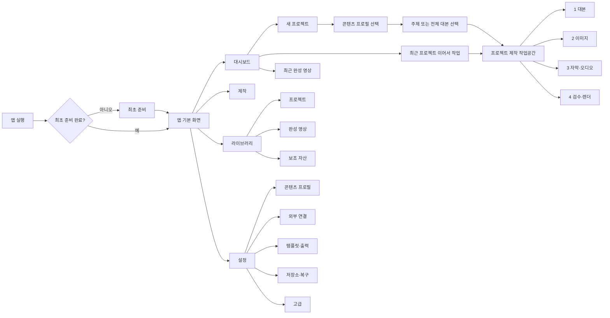

# 개인용 V1 화면 정보구조

상태: 와이어프레임과 화면 개편 구현의 기준으로 사용할 최종 검토안.

기준 문서: [개인용 V1 최종 유저 플로우](./PERSONAL_V1_FINAL_USER_FLOW.md)

목표: 기능을 메뉴마다 흩어놓지 않고, 사용자가 `새 프로젝트 시작`, `정밀 제작`, `이어서 작업`, `완성 영상 찾기`, `기본값 관리` 중 현재 목적에 맞는 화면을 바로 찾게 한다.

## 1. 핵심 IA 결정

### 1차 메뉴는 4개로 제한한다

```text
대시보드
제작
라이브러리
설정
```

| 메뉴 | 한 가지 주목적 |
| --- | --- |
| 대시보드 | 지금 시작하거나 이어서 할 작업을 고른다. |
| 제작 | 선택한 프로젝트 한 편을 단계별로 완성한다. |
| 라이브러리 | 전체 프로젝트, 완성 영상, 재사용 자산을 찾고 관리한다. |
| 설정 | 콘텐츠 프로필, 외부 연결, 템플릿, 저장소와 고급 기능을 관리한다. |

`콘텐츠 프로필`은 매 프로젝트의 핵심 컨텍스트지만 독립적인 1차 메뉴로 두지 않는다. 새 프로젝트에서 반드시 선택하고, 상세 관리는 `설정 > 콘텐츠 프로필`에서 한다.

### 제작의 상위 단계는 4개로 묶는다

```text
대본 → 이미지 → 자막·오디오 → 검수·렌더
```

최종 유저 플로우의 논리 단계를 그대로 7~10개의 화면으로 만들지 않는다. 서로 강하게 연결되는 작업을 네 단계로 묶되, 사용자는 언제든 앞 단계로 돌아갈 수 있다. 음성 방식·화자·보이스·제작 배속은 대본 단계의 접이식 `음성 설정`에서 함께 확정한다.

### 프로젝트와 완성 영상은 분리한다

- 프로젝트는 계속 편집할 수 있는 작업 상태다.
- 완성 영상은 특정 `renderSnapshot`으로 만든 MP4 결과다.
- 두 객체를 같은 카드나 같은 상태값으로 섞지 않는다.

## 2. 전체 사이트맵



## 3. 앱 기본 화면 구조

### 전역 영역

전역 영역에는 다음만 둔다.

- 1차 메뉴 4개
- 현재 화면 제목
- 처리 중인 장시간 작업이 있을 때만 보이는 작업 상태
- 연결 또는 저장소에 조치가 필요할 때만 보이는 경고

다음 정보는 제거한다.

- 앱 사용자명과 계정 메뉴
- 작업공간 전환
- 권한과 관리자 전환
- 고객 선택
- 발행 상태
- 판매·크레딧 상태

정상 상태인 Codex와 Typecast 연결을 모든 화면에서 크게 반복하지 않는다. 연결 문제가 있을 때 대시보드의 조치 항목과 해당 생성 버튼 근처에서만 강조한다.

### 콘텐츠 프로필 컨텍스트 규칙

- 대시보드에서는 최근 사용 프로필을 필터로 보여줄 수 있다. 새 프로젝트 화면에서는 최근 사용 프로필을 기본 선택 후보로 제안할 수 있지만, 프로젝트를 만들기 전에 사용자가 반드시 확인한다.
- 새 프로젝트에서는 콘텐츠 프로필을 반드시 명시적으로 선택한다.
- 제작 작업공간에서는 프로젝트에 저장된 프로필 스냅샷을 고정 배지로 표시한다.
- 제작 중 프로필 배지는 일반 드롭다운으로 바꾸지 않는다. 다른 프로필을 적용하려면 `프로젝트 설정`에서 영향 범위를 확인하고 명시적으로 실행한다.
- 프로젝트의 변경값을 콘텐츠 프로필 원본에 반영할 때는 `현재 값을 프로필 기본값으로 저장`을 명시적으로 실행한다.

이 규칙은 실수로 프로필을 전환해 현재 프로젝트의 보이스, 캐릭터, 템플릿이 바뀌는 것을 막는다.

## 4. 화면별 정보구조

### 4.1 최초 준비

주목적: 개인용 제작에 필요한 최소 환경을 한 번만 준비한다.

필수 항목:

- Codex ChatGPT 구독 연결 확인
- Typecast 연결과 보이스 확인
- 로컬 프로젝트·완성 영상 저장 위치
- 첫 콘텐츠 프로필 생성

앱 자체 사용자 가입, 권한 선택, 워크스페이스 생성은 보여주지 않는다.

### 4.2 대시보드

주목적: 다음 작업을 결정한다.

정보 우선순위:

1. `새 프로젝트 만들기`
2. 마지막 프로젝트 `이어서 작업`
3. 중단·실패하여 조치가 필요한 작업
4. 최근 프로젝트
5. 최근 완성 영상

주요 행동:

- 새 프로젝트 시작
- 마지막 안정 단계부터 이어서 작업
- 최근 완성 영상 재생 또는 폴더 열기
- 조치가 필요한 연결·저장소 문제 해결

숨길 정보:

- 채널 분석과 통계
- 예약·자동 발행
- 템플릿 상세 편집
- 사용자·권한·관리자 정보
- 전체 자산 관리 도구

대시보드는 모든 기능의 전시장이 아니라 다음 행동을 고르는 화면이다.

### 4.3 새 프로젝트 시작

주목적: 제작 작업공간에 들어가기 전 두 가지 필수 선택만 끝낸다.

순서:

1. 콘텐츠 프로필 선택
2. `주제로 시작` 또는 `전체 대본으로 시작` 선택

보여줄 정보:

- 프로필 이름과 핵심 기본값 요약
- 템플릿·기본 보이스·이미지 스타일·캐릭터 수
- 입력 방식 두 가지

숨길 정보:

- 프로필 상세 편집
- 템플릿 좌표 편집
- BGM·SFX 세부 조정
- 발행 설정
- raw JSON 입력

프로필을 수정해야 하면 별도의 `프로필 관리` 링크로 설정 화면을 연다. 새 프로젝트 시작 화면 자체가 설정 화면이 되지 않게 한다.

### 4.4 제작 진입

1차 메뉴의 `제작`은 다음 규칙으로 동작한다.

- 최근에 열어둔 프로젝트가 있으면 마지막 단계의 제작 작업공간으로 돌아간다.
- 열어둔 프로젝트가 없으면 `새 프로젝트`와 `최근 프로젝트 이어서 작업`만 보여주는 간단한 진입 화면을 연다.
- 전체 프로젝트 목록과 일괄 관리는 `라이브러리 > 프로젝트`에서 한다.

### 4.5 제작 작업공간

주목적: 프로젝트 한 편을 끝까지 정밀하게 완성한다.

항상 보여줄 프로젝트 컨텍스트:

- 프로젝트명
- 콘텐츠 프로필 스냅샷
- 현재 프로젝트가 프로필 기본값과 달라졌는지 여부
- 자동 저장 상태
- 출력 규격과 템플릿
- 현재 단계와 단계별 상태
- 변경으로 다시 준비해야 하는 범위
- 차단 오류 수

건강한 외부 연결 상태는 작게 두고, 현재 단계에서 연결이 필요하거나 실패했을 때만 강조한다.

제작 작업공간 상단 컨텍스트에는 `프로젝트 설정` 진입점을 둔다. 여기서는 다음만 관리한다.

- 프로젝트명
- 콘텐츠 프로필 스냅샷과 프로필 원본의 차이
- 새 프로필 기본값의 선택적 적용
- 현재 프로젝트 값을 프로필 기본값으로 저장
- 출력 규격과 템플릿 확인·프로젝트용 변경

일반 단계 편집 설정이나 외부 연결 관리는 프로젝트 설정에 중복해서 넣지 않는다.

#### 제작 단계 1. 대본

포함 작업:

- 주제 입력과 AI 대본 생성
- 전체 대본 입력과 구조 분석
- 사용자가 명시적으로 실행하는 대본 다듬기
- 장면 추가·삭제·순서 변경
- 대사 라인 분리·병합·수정
- 화자와 등장 캐릭터 후보 확인
- 접이식 `음성 설정`: 음성 방식, 화자 지정, 화자별 Typecast 보이스, 제작 배속, 보이스 미리듣기

TTS 앞뒤 무음 제거는 서버 정책으로 적용하고, 문장 뒤 추가 간격은 항상 `0ms`로 고정한다. 라인마다 배속이나 간격을 따로 조정하는 UI는 두지 않는다.

주요 결과: 영상의 장면·대사 라인 구조와 확정된 음성 설정.

주요 다음 행동: `이미지 단계로`.

#### 제작 단계 2. 이미지

포함 작업:

- 이미지 준비 방식 선택
- 크롤링 모드의 검색 세부 방식과 디버그
- 두 AI 모드의 프로젝트 전체 고정 캐릭터 한 명 선택과 콘텐츠 프로필 이동
- 유효한 고정 캐릭터가 없을 때만 표시하는 선택적 이미지 스타일
- 수동 AI 모드의 기본·장면·최종 프롬프트와 복사
- 자동 AI 모드의 Codex 구독 `$imagegen` 기반 GPT Image 2 생성
- 이미지 승인·재생성·교체·재사용

크롤링에서는 스타일·캐릭터 선택창을 표시하지 않는다. 수동·자동 AI 모드에서는 고정 캐릭터 선택창을 표시하되 자동 선택하지 않는다. 유효한 고정 캐릭터가 선택되면 스타일 UI를 숨기고, 선택되지 않았거나 삭제된 경우에는 스타일 UI와 `대본 기준 자동` 상태를 표시한다. 수동 모드에는 실제 생성·일괄 생성·후보 승인 행동을 노출하지 않는다. AI 프롬프트의 `no text`, `square 1:1`은 화면 설정이 아니라 고정 서버 규칙이다.

주요 결과: 장면마다 승인된 시각 자산.

주요 다음 행동: `자막·오디오 단계로`.

#### 제작 단계 3. 자막·오디오

포함 작업:

- 자막 스타일·위치·크기
- BGM 선택·볼륨·켜기/끄기
- SFX 자동 강도
- 장면·라인별 SFX 삭제·교체·재추천
- 오디오 중심 미리듣기

주요 결과: 승인된 자막과 BGM·SFX 설정.

주요 다음 행동: `검수 시작`.

#### 제작 단계 4. 검수·렌더

상위 단계는 하나로 유지하되, 와이어프레임에서는 `검수`와 `렌더`를 같은 단계 안의 두 구분된 섹션으로 표현한다.

하위 순서:

1. 통합 미리보기 업데이트
2. 품질 이슈 확인
3. 필요 시 해당 단계·장면·라인으로 이동
4. 렌더 사전검사
5. 선택적 검수본 렌더
6. 최종 렌더
7. 결과 재생과 로컬 라이브러리 등록

주요 행동:

- 이슈 위치로 이동
- 미리보기 다시 준비
- 사전검사 실행
- 같은 `renderSnapshot`으로 렌더 재시도
- 최종 MP4 재생·폴더 열기·수정본 만들기

### 제작 단계 이동 규칙

- 단계 이동은 자유롭게 허용한다.
- 다음 단계에 필요한 필수 데이터가 없으면 이동 자체를 막기보다 해당 작업을 차단 상태로 표시한다.
- 수정이 하위 단계에 영향을 주면 단계 레일에 `다시 준비 필요`를 표시한다.
- 단계마다 주된 다음 행동은 하나만 강조한다.
- 장면·대사 라인 선택 컨텍스트는 대본, 이미지, 자막·오디오 단계 사이에서 최대한 유지한다.
- 대량 재생성은 복구 지점을 만든 뒤 실행한다.

## 5. 라이브러리 정보구조

라이브러리는 세 그룹으로 나눈다.

### 프로젝트

- 초안·작업 중·검수 필요·렌더 준비·중단·실패 상태
- 마지막 안정 단계와 수정 시각
- 이어서 작업
- 복제해서 수정본 만들기
- 렌더 스냅샷으로 재시도
- 삭제·복구 진입

### 완성 영상

- 최종 MP4와 썸네일
- 연결된 프로젝트와 `renderSnapshot`
- 렌더 날짜와 출력 규격
- 재생
- 폴더 열기·파일 복사
- 이 영상 기준 수정본 만들기
- 렌더 로그

### 보조 자산

- 재사용 이미지·GIF·영상
- BGM·SFX·기타 오디오
- 폴더·태그·미리듣기·교체

`보조 자산`은 프로젝트와 완성 영상보다 낮은 우선순위로 둔다. 휴지통·복구는 독립 1차 메뉴가 아니라 프로젝트 또는 `설정 > 저장소·복구`에서 진입한다.

자산 파일 자체의 소유 위치는 `라이브러리 > 보조 자산`이다. 설정과 콘텐츠 프로필은 파일을 복제해 소유하지 않고, 라이브러리 자산을 기본값으로 참조한다.

렌더 관련 소유권은 다음처럼 고정한다.

- 실패·중단·진행 중 `renderSnapshot`: `라이브러리 > 프로젝트`
- 성공한 최종 MP4와 연결된 `renderSnapshot`: `라이브러리 > 완성 영상`
- 개별 렌더 로그: 해당 프로젝트 또는 완성 영상 상세
- 전역 렌더 환경 진단: `설정 > 고급`

## 6. 설정 정보구조

### 콘텐츠 프로필

프로필 목록과 프로필별 상세 설정을 관리한다.

- 기본 정보: 이름, 현재 대응 YouTube 채널 표시
- 템플릿·출력 규격
- 화자·Typecast 보이스·배속·무음 정책
- AI 이미지 기본 스타일
- AI 이미지용 고정 캐릭터 0명 이상과 기준 이미지·identity 설명
- 자막·BGM·SFX 기본값

프로필 수정은 새 프로젝트에만 기본 적용한다. 단, 기존 프로젝트가 선택한 고정 캐릭터의 외형·기준 이미지는 프롬프트 준비와 자동 생성 시점에 최신 프로필 값을 다시 읽는다.

### 외부 연결

- Codex ChatGPT 구독 연결 상태와 재연결
- Typecast 연결 상태와 보이스 새로고침
- 향후 플랫폼 발행 연결은 개인용 V1에서 숨김

### 템플릿·출력

- 공유 템플릿 목록
- 출력 규격과 렌더 기본값
- 템플릿 복제·관리
- `고급 레이아웃 편집` 진입

### 저장소·복구

- 프로젝트 저장 위치
- 완성 영상 저장 위치
- 자동 저장·백업 상태
- 삭제 항목 복구
- 데이터 내보내기·가져오기

### 고급

- 템플릿 JSON·좌표 편집
- 전역 렌더 환경 진단. 개별 프로젝트·완성 영상 로그는 각 객체의 상세에서 확인한다.
- raw JSON 보기·내보내기
- 내부 디버그 기능

고급 기능은 사용자가 명시적으로 열기 전까지 기본 제작 화면에 노출하지 않는다.

## 7. 상태와 오류의 위치

오류를 별도 오류 페이지나 전역 알림함에 모으지 않는다. 사용자가 바로 수정할 수 있는 위치에 둔다.

| 상태 | 표시 위치 | 행동 |
| --- | --- | --- |
| Codex 미연결 | 대본·이미지 생성 버튼 근처, 대시보드 조치 항목 | 연결 설정 열기 |
| Typecast 미연결 | 대본 단계 음성 설정 영역 | 연결 확인 후 해당 라인 재시도 |
| TTS 실패 | 해당 대사 라인 | 선택 라인만 다시 생성 |
| 이미지 실패 | 해당 장면 카드 | 기존 승인 이미지 유지, 장면만 다시 생성 |
| 프로필과 프로젝트 값 차이 | 프로젝트 컨텍스트 | 차이 보기, 프로젝트 유지, 프로필로 저장 |
| 하위 단계 무효화 | 제작 단계 레일 | 다시 준비할 단계로 이동 |
| 렌더 차단 오류 | 검수·렌더 사전검사 | 오류 클릭 시 원인 단계·항목으로 이동 |
| 렌더 실패 | 렌더 결과 영역 | 같은 스냅샷으로 재시도 |
| 로컬 파일 누락 | 해당 프로젝트·자산 | 파일 다시 연결 또는 복구 |

## 8. 현재 화면의 목표 IA 매핑

이 표는 목표 의미를 정의하며, 실제 URL 변경 여부는 구현 계획에서 결정한다.

| 현재 화면 | 목표 위치와 처리 |
| --- | --- |
| `/home` | `대시보드`로 유지·정리. `/publish`로 보내는 기능 플래그 분기는 제거 대상. |
| `/shorts-json-studio` | `제작 작업공간`으로 유지하고 4단계 구조로 재편. |
| `/quick-studio` | 1차 메뉴와 개인용 V1에서 숨김. 향후 검증된 정밀 플로우의 자동 실행 기능으로만 재설계. |
| `/assets` | `라이브러리`로 유지하고 프로젝트·완성 영상·보조 자산을 분리. |
| `/settings` | 설정 허브로 유지하고 목적별 하위 구조로 재편. |
| `/channel-categories` | `설정 > 콘텐츠 프로필`로 흡수하고 고객·category 용어 제거. |
| `/layout-studio` | `설정 > 템플릿·출력 > 고급 레이아웃 편집`으로 이동. |
| `/shorts-json-studio/template-manager` | `설정 > 템플릿·출력`으로 이동. |
| `/settings/history` | `설정 > 저장소·복구`로 이동. |
| `/trash` | 1차 메뉴에서 제거하고 라이브러리 또는 저장소·복구의 보조 진입점으로 이동. |
| `/publish` | 개인용 V1 기본 UI에서 숨김·보류. |
| `/login` | 앱 자체 로그인은 개인용 V1에서 우회·제거 대상. Codex·Typecast 연결은 `설정 > 외부 연결`에서 별도로 유지. |
| `/admin/*` | 개인용 V1 기본 UI에서 숨김·제거 대상. |
| `AppLayout` | 1차 메뉴를 대시보드·제작·라이브러리·설정으로 축소하고 사용자·권한 컨텍스트 제거. |

기존 URL을 당장 삭제할 필요는 없다. 화면 개편 중에는 새 위치로 연결하거나 숨기고, 의존성이 제거된 뒤 코드 삭제를 결정한다.

## 9. 기본 UI에서 숨길 기능

- 빠른 제작과 모바일 퀵 패널
- 자동·예약 발행과 YouTube 분석
- 사용자·관리자·권한·작업공간
- 고객·category 관리 용어
- 판매용 라이선스·크레딧·OpenAI API 키 입력
- 레이아웃 스튜디오와 템플릿 JSON의 1차 노출
- 휴지통의 1차 노출
- 내부 telemetry와 디버그 옵션
- raw JSON 기본 입력

## 10. IA 승인 기준

- 1차 메뉴가 대시보드·제작·라이브러리·설정 4개뿐이다.
- 새 프로젝트는 콘텐츠 프로필 선택과 입력 방식 선택만 거쳐 제작으로 진입한다.
- 제작 작업공간의 상위 단계가 4개뿐이다.
- 콘텐츠 프로필은 항상 문맥으로 보이지만 제작 중 실수로 바꿀 수 없다.
- 한 화면의 주된 다음 행동은 하나다.
- 프로젝트와 완성 영상이 서로 다른 목록과 상태로 관리된다.
- 생성 실패가 전역 오류가 아니라 해당 라인·장면에 표시된다.
- 고급 템플릿·JSON·디버그 기능이 메인 제작을 방해하지 않는다.
- 자동 저장, 변경 영향, 차단 오류가 제작 작업공간에서 확인된다.
- 발행·판매·관리자·모바일 기능 없이도 개인용 V1 화면 구조가 완결된다.

## 11. 다음 단계와의 경계

이 문서는 화면의 계층과 정보 소유권을 정한다. 열 너비, 카드 배치, 패널 위치, 버튼 모양, 색상과 같은 시각적 결정은 다음 단계인 와이어프레임에서 정한다.

와이어프레임은 다음 순서로 만든다.

1. 앱 기본 화면과 1차 내비게이션
2. 대시보드와 새 프로젝트 시작
3. 제작 작업공간 공통 프레임
4. 제작 4단계의 핵심 상태
5. 라이브러리
6. 설정과 콘텐츠 프로필
