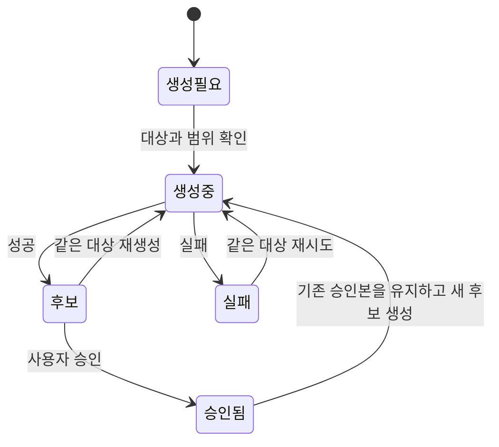

# 개인용 V1 UI 디자인 시스템

상태: 고충실도 화면 설계와 개인용 V1 UI 구현의 기준으로 사용할 최종 검토안.

기준 문서:

- [개인용 V1 최종 유저 플로우](./PERSONAL_V1_FINAL_USER_FLOW.md)
- [개인용 V1 화면 정보구조](./PERSONAL_V1_SCREEN_INFORMATION_ARCHITECTURE.md)
- [개인용 V1 PC 와이어프레임](./PERSONAL_V1_DESKTOP_WIREFRAMES.md)

목표: 화려한 AI 데모가 아니라, 긴 제작 과정에서 실수와 재작업을 줄이는 차분하고 신뢰 가능한 PC 제작 도구를 만든다.

## 1. 디자인 방향

디자인 키워드:

```text
정밀함 · 차분함 · 높은 판독성 · 명확한 상태 · 낮은 시각 소음
```

화면은 다음 인상을 줘야 한다.

- 사용자가 지금 해야 할 행동이 분명하다.
- 현재 선택한 장면·라인과 생성 범위가 분명하다.
- 승인본, 후보, 실패 결과가 섞이지 않는다.
- 대본·음성·이미지처럼 긴 목록을 오래 편집해도 피로하지 않다.
- 앱이 조용히 대체하거나 추측하지 않고 상태를 사실대로 보여준다.

피해야 할 표현:

- AI 제품을 강조하는 네온·보라색 그라데이션
- 모든 카드의 강한 그림자와 유리 질감
- 생성 버튼의 반짝임, 반복 펄스, 과한 애니메이션
- 모든 상태에 다른 장식색을 부여하는 방식
- 큰 히어로 영역과 통계형 SaaS 대시보드
- 썸네일만 크게 보여주는 콘텐츠 갤러리 중심 화면

개인용 V1은 밝은 테마 하나만 설계한다. 다크 모드는 핵심 제작 플로우가 안정된 뒤 별도로 검토한다.

## 2. 정보 위계

한 화면의 시각 우선순위는 다음 순서로 고정한다.

1. 현재 상태에서 실행해야 할 primary 행동
2. 현재 선택한 프로젝트·장면·라인과 편집 대상
3. 차단 오류와 다시 준비해야 하는 변경 영향
4. 승인된 결과와 새 후보
5. 설정, 로그, 고급 정보

화면 전체 primary는 하나다. 다음 단계 이동, 선택 항목 재생성, 파일 교체, 상세 열기는 secondary 또는 local action으로 보인다.

## 3. 색상

기존 `globals.css`의 파랑·슬레이트 계열은 유지하되, 그라데이션과 반투명 변형을 줄이고 역할을 명확히 한다.

### 기본 토큰

| 기존 토큰 | 개인용 V1 기준값 | 용도 |
| --- | --- | --- |
| `--surface-canvas` | `#F7F8FA` | 앱 전체 배경 |
| `--surface-card` | `#FFFFFF` | 카드, 작업 패널, 드로어 |
| `--surface-subtle` | `#F3F4F6` | 선택되지 않은 보조 영역 |
| `--surface-selected` | `#EFF6FF` | 현재 선택 행·단계의 부드러운 배경 |
| `--text-primary` | `#111827` | 제목과 핵심 내용 |
| `--text-secondary` | `#4B5563` | 본문과 설명 |
| `--text-muted` | `#6B7280` | 시각·경로·보조 메타 |
| `--border-subtle` | `#E5E7EB` | 일반 구분선 |
| `--border-strong` | `#D1D5DB` | 입력, 선택, 주요 패널 경계 |
| `--accent-primary` | `#2563EB` | 화면 primary, 현재 단계 |
| `--accent-primary-hover` | `#1D4ED8` | primary hover |
| `--accent-primary-soft` | `#DBEAFE` | 선택 배경, 정보 배지 |
| `--focus-ring` | `#2563EB` | 키보드 포커스 |

검증한 명도 대비:

| 조합 | 대비 |
| --- | --- |
| primary text / white | `17.74:1` |
| secondary text / white | `7.56:1` |
| muted text / white | `4.83:1` |
| primary blue / white | `5.17:1` |

작은 메타 텍스트는 `--text-muted`보다 옅게 만들지 않는다.

### 상태 토큰

| 상태 | 전경 | 배경 | 테두리 | 함께 표시할 것 |
| --- | --- | --- | --- | --- |
| 정보·생성 중 | `#075985` | `#F0F9FF` | `#BAE6FD` | 정보 아이콘 또는 진행률 |
| 승인·완료 | `#166534` | `#F0FDF4` | `#BBF7D0` | 체크 아이콘과 상태명 |
| 경고·다시 필요 | `#92400E` | `#FFFBEB` | `#FDE68A` | 경고 아이콘과 영향 범위 |
| 오류·차단 | `#B91C1C` | `#FEF2F2` | `#FECACA` | 오류 아이콘, 원인, 이동·재시도 |
| 후보 있음 | `#5B21B6` | `#F5F3FF` | `#DDD6FE` | `후보` 텍스트와 후보 수 |
| 미시작·중립 | `#4B5563` | `#F3F4F6` | `#E5E7EB` | 상태명 |

상태는 색상만으로 표현하지 않는다. 아이콘, 상태 텍스트, 개수 또는 범위를 함께 표시한다.

## 4. 타이포그래피

### 글꼴 정책

- 기본 글꼴은 `Pretendard Variable` 하나로 통일하고 앱에 로컬 번들한다.
- fallback은 `"Segoe UI", "Noto Sans KR", system-ui, sans-serif`로 둔다.
- 외부 CDN 글꼴 import에 의존하지 않는다. Electron 패키징과 오프라인 실행을 고려한다.
- 현재 `studio-fonts.css`에 있는 여러 원격 글꼴 import는 구현 단계에서 제거 대상이다.

### 크기 체계

| 역할 | 크기 / 행간 / 굵기 | 사용 위치 |
| --- | --- | --- |
| 페이지 제목 | `24 / 32 / 700` | 대시보드, 라이브러리, 설정 |
| 프로젝트 제목 | `20 / 28 / 700` | 제작 상단 컨텍스트 |
| 섹션 제목 | `16 / 24 / 600` | 카드·작업영역 제목 |
| 본문 | `14 / 22 / 400` | 설명, 대본 라인 |
| 컨트롤 | `14 / 20 / 500` | 버튼, 탭, 입력 |
| 표·리스트 | `13 / 20 / 400~500` | 고밀도 제작 목록 |
| 메타 | `12 / 18 / 500` | 저장 시각, 경로, 보조 상태 |
| 코드·ID | `12 / 18 / 400` monospace | snapshot ID, 로그, 파일 키 |

본문과 컨트롤의 기본 글자 크기를 `14px` 아래로 낮추지 않는다. `12px`는 부가 메타에만 사용한다.

## 5. 간격·반경·그림자

### 간격

기존 4px 배수 체계를 유지한다.

```text
4 · 8 · 12 · 16 · 20 · 24 · 32
```

| 적용 | 기준 |
| --- | --- |
| 화면 좌우 여백 | `24px` |
| 큰 화면 섹션 간격 | `24px` |
| 패널 내부 간격 | `16px` |
| 관련 컨트롤 간격 | `8px` |
| 테이블 셀 좌우 | `12~16px` |

### 반경

| 토큰 | 값 | 용도 |
| --- | --- | --- |
| `--radius-sm` | `6px` | 배지, 작은 입력 |
| `--radius-md` | `8px` | 버튼, 입력, 선택 행 |
| `--radius-lg` | `12px` | 카드, 드로어, 모달 |

18~20px 이상의 큰 반경과 모든 상태의 pill 표현은 줄인다. pill은 짧은 상태 배지에만 사용한다.

### 그림자

- 일반 카드와 작업 패널은 그림자를 사용하지 않고 테두리로 구분한다.
- 드로어, 모달, 드래그 중인 항목에만 elevation을 사용한다.
- hover에서 카드 전체가 위로 움직이는 효과를 사용하지 않는다.

## 6. PC 레이아웃

### 전역 셸

| 영역 | 1440px 기준 | 1280px 기준 |
| --- | --- | --- |
| 전역 사이드바 | `208px` | `200px` |
| 본문 여백 | `24px` | `20px` |
| 대시보드·설정 최대폭 | `1280px` | 가용 폭 전체 |
| 제작 본문 최대폭 | 제한 없음 | 제한 없음 |

사이드바 active 항목은 다음 세 가지로 함께 표현한다.

- 부드러운 선택 배경
- 좌측 3px 인디케이터
- 아이콘과 라벨의 명확한 강조

### 제작 작업공간

1440px 이상:

```text
전역 사이드바 208
장면·라인 탐색기 232
주 작업영역 가변, 최소 560
선택 인스펙터 320
```

1280px:

- 장면·라인 탐색기는 `216px`로 유지한다.
- 주 작업영역을 우선한다.
- 선택 인스펙터는 기본 접힘이며 필요할 때 우측 드로어로 연다.
- 단계 레일은 두 줄로 감싸지 않고 짧은 라벨 또는 가로 이동을 사용한다.
- 오류 원인 요약은 인스펙터가 닫혀도 선택 행 가까이에 남긴다.

모바일 하단 내비게이션은 개인용 V1 디자인 범위에서 제외한다.

## 7. 공통 컴포넌트

### 버튼

| 유형 | 사용 | 기준 |
| --- | --- | --- |
| Primary | 현재 화면의 다음 행동 | 화면 전체 1개, 높이 `40~44px` |
| Secondary | 단계 이동, 저장, 교체 | 중립 테두리, 그림자 없음 |
| Ghost | 접기, 상세 열기, 보조 이동 | 배경 없음 |
| Destructive | 삭제, 승인본 폐기 | 빨간색 사용, 일반 오류 재시도에는 사용하지 않음 |
| Icon button | 닫기, 더보기 | 접근 가능한 이름과 tooltip 필수 |

버튼 비활성화는 opacity만 낮추지 않는다. 비활성 상태와 함께 이유를 버튼 근처에 표시한다.

### 입력

- 기본 높이 `40px`, textarea는 콘텐츠에 따라 확장한다.
- 라벨은 입력 위에 둔다.
- 도움말과 오류 메시지는 입력 아래 같은 위치를 사용한다.
- 오류 상태는 테두리, 아이콘, 메시지를 함께 표시한다.
- `focus-visible`은 2px focus ring과 2px offset을 사용한다.

### 카드와 패널

카드는 다음에만 사용한다.

- 대시보드의 마지막 프로젝트
- 새 프로젝트의 콘텐츠 프로필 선택
- 완성 영상 썸네일
- 선택 가능한 생성 후보

제작 작업공간, 설정, 라이브러리 테이블은 카드 중첩 대신 패널과 구분선을 사용한다.

### 배지

- 아이콘 + 상태명 + 필요 시 개수로 구성한다.
- 높이 `24~28px`의 작은 컴포넌트다.
- `승인됨 8`, `후보 2`, `실패 1`, `다시 필요 3`처럼 짧게 쓴다.
- 배지만으로 중요한 오류 설명을 대신하지 않는다.

### 탭과 단계 레일

- 일반 탭은 하단 인디케이터와 텍스트 강조를 사용한다.
- 단계 레일은 `상태 아이콘 / 단계 번호·라벨 / 상태 텍스트`로 구성한다.
- 현재 단계, 완료, 다시 필요, 차단을 아이콘과 텍스트로 구분한다.
- 단계 레일은 자유 이동 컨트롤이며, primary CTA처럼 보이지 않는다.

### 장면·라인 탐색기

한 행에 다음을 보여준다.

- 장면 또는 라인 이름
- 화자 또는 짧은 메타
- 승인·실패·다시 필요 상태 아이콘
- 현재 선택 표시

현재 선택은 `선택 배경 + 좌측 인디케이터 + 선택 상태`로 표현한다. 오류는 별도의 오류 아이콘과 상태명으로 표시한다.

장면이 많아질 때를 대비해 다음을 제공한다.

- 장면 접기·펼치기
- 검색
- `미완료만` 필터
- 현재 단계에서 영향받은 항목 표시

### 표

- 기본 행 높이 `44px`, 고밀도 모드는 `40px`다.
- 세로 경계선 없이 가로 구분선만 사용한다.
- 선택 행은 배경과 좌측 인디케이터로 표시한다.
- 긴 한국어는 핵심 열에서 최대 2줄, 보조 열에서 말줄임 처리한다.
- 행 전체가 선택 가능하더라도 내부 버튼은 독립적인 키보드 대상으로 유지한다.

### 드로어와 모달

드로어:

- 프로젝트 설정
- 1280px의 선택 인스펙터
- 긴 오류·렌더 스냅샷 상세

모달:

- 일괄 재생성
- 프로필 기본값 적용 또는 저장
- 승인본 폐기
- 삭제

모달에는 대상 수, 변경 범위, 유지되는 승인 자산, 복구 지점 여부를 명시한다.

## 8. 제작 상태 체계

| 상태 | 화면 표현 | 허용 행동 |
| --- | --- | --- |
| 미시작 | 중립 아이콘 + `미시작` | 생성 |
| 생성 필요 | 빈 상태 아이콘 + 대상 수 | 선택 또는 일괄 생성 |
| 생성 중 | 진행 표시 + `3/8` + 현재 항목 | 중복 실행 차단 |
| 후보 있음 | 후보 배지 + 승인본과 나란히 비교 | 승인, 재생성, 폐기 |
| 승인됨 | 체크 + 승인 시각 또는 버전 | 새 후보 생성 가능 |
| 다시 준비 필요 | 경고 + 원인 단계 | 영향 항목 열기 |
| 차단 오류 | 오류 + 원인 + 범위 | 해당 항목 이동·재시도 |
| 진행 가능 경고 | 경고 + `계속 가능` | 무시하고 진행 가능 |

생성 자산의 기본 상태 전이는 다음과 같다.



## 9. 화면별 시각 기준

### 대시보드

- 상단에는 페이지 제목과 `새 프로젝트 만들기`만 둔다.
- 마지막 프로젝트가 가장 큰 작업 카드다.
- 조치 필요 영역은 오류가 있을 때만 보인다.
- 최근 프로젝트는 표, 최근 완성 영상은 낮은 높이의 미디어 행을 사용한다.
- 통계 카드와 분석 그래프는 두지 않는다.

### 새 프로젝트

- 1단계 프로필 확인과 2단계 입력 방식을 별도 화면 상태로 보여준다.
- 선택한 프로필 카드는 명확한 선택 표시와 기본값 요약을 제공한다.
- 프로필 수정 폼을 열지 않는다.
- `이 프로필로 계속`, `프로젝트 만들고 대본 단계 열기`가 각 화면의 primary다.

### 제작

- 프로젝트 헤더와 단계 레일은 고정된 문맥이다.
- 좌측은 탐색, 중앙은 현재 단계의 작업, 우측은 선택 항목의 세부·로컬 액션만 담당한다.
- 하단 변경 영향 바는 한 줄 요약과 `영향 항목 보기`만 제공한다.
- 전체 설정·히스토리·로그를 부유 버튼으로 상시 노출하지 않는다.

### 음성

- 중앙 표에서 라인, 화자, 보이스, 배속, 생성·승인 상태, 미리듣기를 스캔할 수 있다.
- 선택 라인 인스펙터에서 무음 제거와 뒤 간격 `0ms`를 확인한다.
- `미완료 라인 2개 생성`처럼 범위가 primary 라벨에 들어간다.
- 실패한 라인은 다른 성공 라인의 상태를 바꾸지 않는다.

### 이미지

- 승인본과 새 후보를 서로 다른 열 또는 명확한 라벨로 비교한다.
- 장면 카드에는 `승인본`, `후보`, `실패`, `생성 필요` 상태를 텍스트로 표시한다.
- `장면 04만 재시도`처럼 생성 범위를 명시한다.
- 새 후보가 성공하기 전까지 승인본을 유지한다.

### 검수·렌더

- 미리보기, 사전검사, 최종 렌더 중 현재 가능한 행동 하나만 primary다.
- 차단 오류와 진행 가능한 경고를 분리한다.
- 오류를 누르면 원인 단계와 장면·라인으로 이동한다.
- `renderSnapshot`이 없을 때, 생성 예정일 때, 생성된 뒤를 구분한다.
- 렌더 실패에서는 같은 snapshot으로 재시도하는 행동만 강조한다.

### 라이브러리와 설정

- 프로젝트 목록은 상태 중심 표다.
- 완성 영상은 썸네일과 재생·파일 행동 중심이다.
- 설정은 상위 탭, 좌측 목록, 우측 상세의 관리형 구조다.
- 설정 첫 화면을 카드 메뉴판으로 만들지 않는다.

## 10. 아이콘과 모션

### 아이콘

- Lucide 계열의 1.5~2px outline 아이콘 한 세트만 사용한다.
- 기본 크기는 `16px`, 주요 내비게이션은 `18px`, 큰 상태는 `20px`다.
- action 아이콘은 텍스트 라벨과 함께 사용한다.
- 단독 아이콘 버튼은 접근 가능한 이름과 tooltip을 제공한다.

### 모션

- 기본 전환은 `150~220ms`다.
- 드로어와 모달에만 위치 이동을 사용한다.
- 생성 중 spinner와 실제 진행률만 반복 애니메이션을 허용한다.
- `prefers-reduced-motion`에서는 이동·반복 모션을 제거한다.
- hover에서 카드가 위로 떠오르거나 확대되지 않는다.

## 11. 접근성 기준

- 일반 텍스트와 상태 텍스트는 WCAG AA 대비를 충족한다.
- 모든 버튼, 링크, 탭, 행 선택에 명확한 `:focus-visible`이 있어야 한다.
- 단계 레일과 탭에는 현재 위치를 프로그램적으로 표시한다.
- 생성 진행 상태는 live region으로 알린다.
- 비활성 버튼 근처에 이유와 해결 행동을 표시한다.
- 오류·경고·완료는 색상 외에 아이콘과 텍스트로 구분한다.
- 긴 프로젝트명·프로필명·보이스명은 2줄 또는 말줄임 정책을 적용한다.
- 키보드로 사이드바 → 단계 레일 → 탐색기 → 주 작업 → 인스펙터 순서로 이동한다.
- 모달이 열리면 포커스를 내부에 가두고 닫은 뒤 원래 위치로 돌려보낸다.

필수 검증 뷰포트:

```text
1440 × 900
1280 × 800
```

## 12. 현재 CSS에서의 정리 방향

### 유지

- `--color-*`, `--surface-*`, `--text-*`, `--border-*`, `--state-*`
- `--space-*`, `--radius-*`, `--motion-*`
- `.btn-primary`, `.btn-secondary`, `.input-field`의 기본 구조
- 기존 제작 오케스트레이션과 preview·render·result 패널의 데이터 기능

### 수렴

- `page-*`, `settings-*`, `studio-*`에 반복된 카드와 패널 헤더
- 화면별로 달라진 버튼 높이·반경·굵기
- 중복된 상태 배너와 상태 pill
- 템플릿·브랜딩·고급 설정의 부유 패널

### 제거 또는 비노출

- 개인용 V1의 `quick-*`, `admin-*`, publish 중심 UI
- 모바일 하단 내비게이션
- 일반 패널의 그라데이션과 강한 그림자
- hover 카드 이동 효과
- 외부 CDN 글꼴 의존

### 새로 정의

- 개인용 V1 프로젝트 헤더
- 4단계 레일
- 장면·라인 탐색기
- 선택 항목 인스펙터와 1280px 드로어
- 상태 배지와 변경 영향 바
- 프로필 선택기
- 승인본·후보 비교
- 상태 기반 검수·렌더 CTA

구현 시 `globals.css`에 계속 추가하지 않고 토큰, 공통 컴포넌트, 화면 레이아웃을 분리한다.

```text
styles/
  tokens.css
  base.css
  components.css
  app-shell.css
  production-workspace.css
```

## 13. 고충실도 승인 기준

- 화면을 처음 봤을 때 현재 primary 행동 하나가 먼저 보인다.
- 현재 콘텐츠 프로필 스냅샷과 프로젝트 변경값을 구분할 수 있다.
- 선택한 장면·라인, 실패 항목, 승인 상태를 동시에 찾을 수 있다.
- 부분 재생성의 대상 수와 범위가 버튼 라벨에 보인다.
- 승인본과 후보가 색상 없이도 구분된다.
- 차단 오류와 진행 가능한 경고가 섞이지 않는다.
- 1280px에서 인스펙터를 접어도 중앙 작업영역과 오류 요약이 유지된다.
- 포커스 위치가 모든 주요 컨트롤에서 분명하다.
- 화면에 원격 글꼴, 모바일, 발행, 판매, 사용자·관리자 전제가 없다.
- 과한 카드, 그림자, 그라데이션 없이도 정보 위계가 선명하다.

## 14. 다음 단계와의 경계

이 문서는 개인용 V1의 시각 언어와 컴포넌트 규칙을 확정한다. 다음 단계에서는 공통 셸과 대시보드부터 실제 애플리케이션 코드에 적용하고, 화면 단위로 브라우저 검증과 회귀 테스트를 진행한다.
